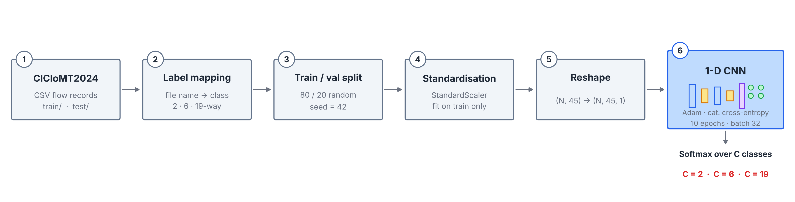
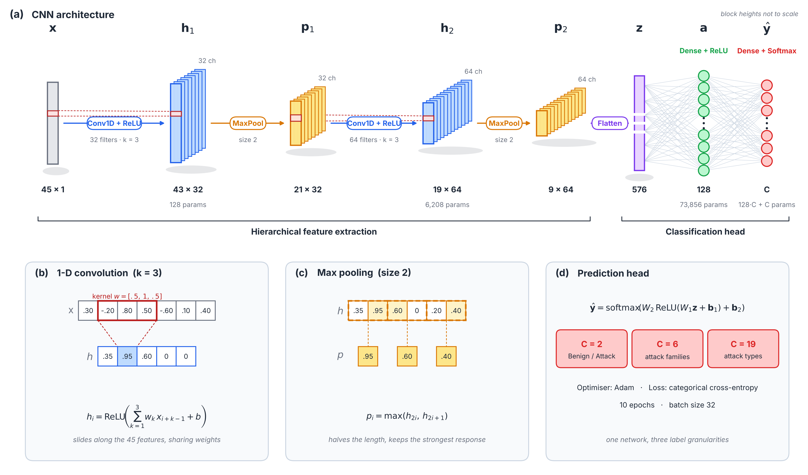
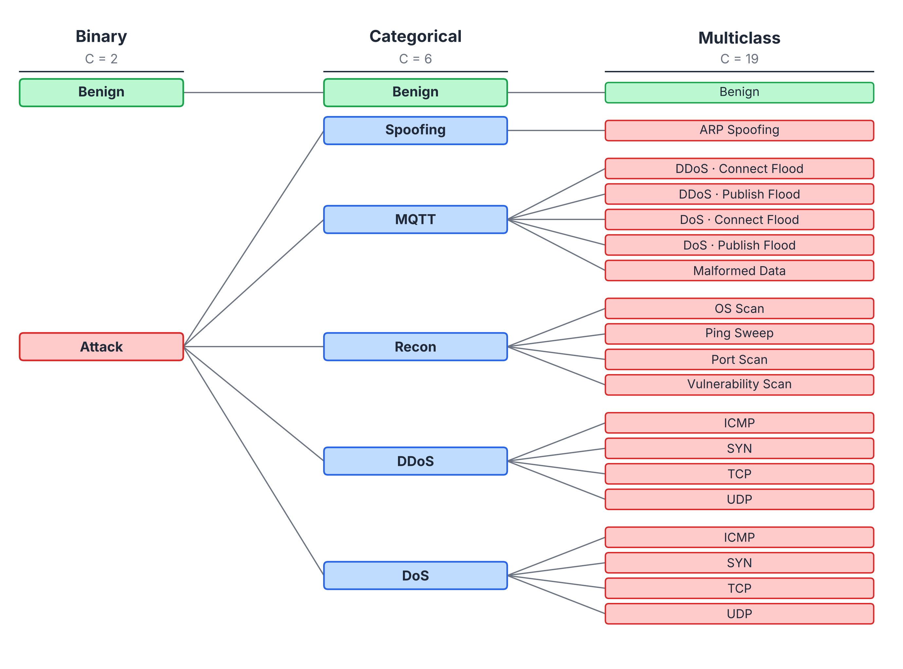

<div align="center">

# Securing Healthcare with Deep Learning
### A CNN-Based Model for Medical IoT Threat Detection

**Alireza Mohammadi · Hosna Ghahramani · Seyyed Amir Asghari · Mehdi Aminian**

*19th Iranian Conference on Intelligent Systems (ICIS 2024) · IEEE*

[](https://doi.org/10.1109/ICIS64839.2024.10887510)
[](https://arxiv.org/abs/2410.23306)
[](https://youtu.be/hPV5H9kTbYM?si=fWtb_eaIiLQ3uGEy)
[](https://www.python.org/downloads/)
[](https://www.tensorflow.org/)
[](LICENSE)

[Paper](https://arxiv.org/abs/2410.23306) · [Method](#method) · [Quick start](#quick-start) · [Results](#results) · [Citation](#citation)

</div>

---

## Abstract

The Internet of Medical Things (IoMT) connects patient monitors, infusion pumps and diagnostic devices to hospital networks, expanding the attack surface of healthcare systems. This repository is the official implementation of a lightweight **one-dimensional convolutional neural network (1D-CNN)** that detects and classifies network attacks on IoMT traffic. Evaluated on the **CICIoMT2024** benchmark, a single architecture handles three tasks of increasing granularity: **binary** (2-class), **categorical** (6-class) and **multiclass** (19-class) classification. The paper reports accuracy of about 0.99 on all three tasks and improvements over previously published methods.

## Highlights

- **One model, three granularities.** The same network solves 2-, 6- and 19-way classification; only the softmax width changes.
- **Compact.** About 83 K trainable parameters for the 19-class setting, with two convolutional blocks and one hidden dense layer.
- **Reproducible.** Fixed split seed, deterministic label mapping from file names, and a single command to train and evaluate.
- **Tabular-friendly.** Each flow record's 45 features are treated as a 1-D signal, so convolutions can pick up local feature interactions.

## Method

### Pipeline

<div align="center">

</div>

1. **Data.** CICIoMT2024 flow-level CSVs, split into `train/` and `test/` by the dataset authors.
2. **Label mapping.** Labels come from file names and are collapsed into 2, 6 or 19 classes (see below).
3. **Train/validation split.** 80/20 random split of the training rows (`random_state=42`).
4. **Standardisation.** `StandardScaler` is fit on the training portion only, then applied to validation and test.
5. **Reshape.** Features become a sequence of shape `(N, 45, 1)`.
6. **Training.** The CNN is trained with Adam and categorical cross-entropy for 10 epochs at batch size 32.

### Architecture

<div align="center">

</div>

| # | Layer | Output shape | Parameters |
|:-:|---|:-:|--:|
| 1 | Input | 45 × 1 | – |
| 2 | Conv1D (32 filters, k=3, ReLU) | 43 × 32 | 128 |
| 3 | MaxPool1D (2) | 21 × 32 | – |
| 4 | Conv1D (64 filters, k=3, ReLU) | 19 × 64 | 6,208 |
| 5 | MaxPool1D (2) | 9 × 64 | – |
| 6 | Flatten | 576 | – |
| 7 | Dense (128, ReLU) | 128 | 73,856 |
| 8 | Dense (C, Softmax) | C | 128·C + C |

Parameter counts assume the 45 input features of CICIoMT2024. For C = 19 the total is 82,643.

### Classification tasks

<div align="center">

</div>

| Task | `--class_config` | Classes |
|---|:-:|---|
| Binary | `2` | Benign, Attack |
| Categorical | `6` | Benign, Spoofing, MQTT, Recon, DDoS, DoS |
| Multiclass | `19` | Benign, ARP Spoofing, 5 MQTT, 4 Recon, 4 DDoS and 4 DoS attack types |

## Results

<div align="center">


*Performance across the three classification tasks (from the paper).*

</div>

Full tables and comparison with prior work are in the [paper](https://arxiv.org/abs/2410.23306). Running `main.py` prints test loss, accuracy, weighted precision, recall and F1, a per-class report and the confusion matrix.

## Quick start

### 1. Clone and install

```bash
git clone https://github.com/alirezamohamadiam/Securing-Healthcare-with-Deep-Learning-A-CNN-Based-Model-for-medical-IoT-Threat-Detection.git
cd Securing-Healthcare-with-Deep-Learning-A-CNN-Based-Model-for-medical-IoT-Threat-Detection
pip install -r requirements.txt
```

A virtual environment is recommended. A GPU is optional; the model is small enough to train on CPU.

### 2. Get the data

Download **CICIoMT2024** (CSV version) from the [University of New Brunswick CIC](https://www.unb.ca/cic/datasets/iomt-dataset-2024.html) and place the files as follows. The full file list is in [`README_DATA.md`](README_DATA.md).

```
data/
├── train/   # 51 CSV files
└── test/    # 21 CSV files
```

### 3. Train and evaluate

```bash
cd src
python main.py --class_config 2     # binary
python main.py --class_config 6     # categorical
python main.py --class_config 19    # multiclass
```

## Repository structure

```
.
├── assets/
│   ├── architecture.{png,pdf,svg}     # model figure
│   ├── pipeline.{png,pdf,svg}         # pipeline figure
│   ├── label_taxonomy.{png,pdf,svg}   # 2/6/19-class label hierarchy
│   └── make_figures.py                # regenerates all figures (matplotlib only)
├── data/
│   ├── train/                         # training CSVs (not included)
│   └── test/                          # testing CSVs (not included)
├── src/
│   ├── data_loader.py                 # loading, label mapping, preprocessing
│   ├── model.py                       # CNN definition and training loop
│   └── main.py                        # CLI entry point and evaluation
├── README_DATA.md                     # dataset preparation guide
├── requirements.txt
└── LICENSE
```

To regenerate the figures: `python assets/make_figures.py`. Vector PDF and SVG versions are included for use in papers and slides.

## Citation

If this code or paper is useful in your work, please cite:

```bibtex
@inproceedings{mohammadi2024securing,
  title        = {Securing Healthcare with Deep Learning: A CNN-Based Model for Medical IoT Threat Detection},
  author       = {Mohammadi, Alireza and Ghahramani, Hosna and Asghari, Seyyed Amir and Aminian, Mehdi},
  booktitle    = {2024 19th Iranian Conference on Intelligent Systems (ICIS)},
  pages        = {168--173},
  year         = {2024},
  organization = {IEEE},
  doi          = {10.1109/ICIS64839.2024.10887510}
}
```

- IEEE Xplore (official version): <https://doi.org/10.1109/ICIS64839.2024.10887510>
- arXiv (open access): <https://arxiv.org/abs/2410.23306>

## License

Released under the [MIT License](LICENSE).

## Acknowledgements

Experiments use the CICIoMT2024 dataset from the Canadian Institute for Cybersecurity (University of New Brunswick). Please cite the dataset authors as well when using it.

<div align="center">

If you find this work useful, please consider giving the repository a ⭐

</div>
